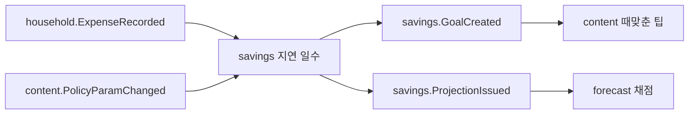

# FEATURE-012: 저축 목표 — 이걸 모으려면 얼마나 걸리나

> 초안 2026-10-30. 읽기 쉬운 판: `pm/docs/2026-10-30-money-domains-spec.html`(리서치 출처 전부). 아키텍처: `salt-microFe/docs/architecture/2026-10-30-domain-zones.html` · `salt-server/docs/2026-10-30-msa-kotlin-migration.html`.

> 영역 REQ(2026-10-30): `DB-REQ-037` · `SRV-REQ-045` · `BFF-REQ-047` · `FE-REQ-056` · `RN-REQ-033` · `FC-REQ-024`. 결정 `ADR-005` · `ADR-006` · `ADR-007`, 전 영역 계획 `requirements/specs/to-do/MONEY-domains-global-plan.md`.

## TL;DR

- 결혼 · 주거 · 첫 차 · 여행 · 비상금 · 출산 목표를 만들고 "매달 얼마 / 언제"를 서버가 계산한다.
- 도달 시점은 한 점이 아니라 **구간 + 적중 이력**(ADR-003 정신). 목표 사이 돈 옮기기 시뮬레이터.
- 바탕은 **모으는 재미**: 채워지는 장면 · 실물 환산 · 도장판 · 엽서. 앱의 칭찬 · 재촉 · 벌칙은 없다.

## 배경과 문제

- 지금 목표는 이름 · 금액 · 날짜 칸뿐이다(`entities/goal` · `features/add-goal` · 서버 `src/modules/goals` 601줄).
- 사람은 미래 저축을 부풀려 추정한다(Dholakia 2011) — 한 점 날짜는 거의 늘 틀린다.
- 2024 금융이해력 조사에서 장기 재무목표 설정이 42.5점으로 가장 낮은 축(보도 기준, 원문 미대조).

## 목표

- 사용자가 목표마다 "월 적립액 ↔ 도달 시점"을 양방향으로 알 수 있다.
- 여러 목표의 우선순위를 숫자로 비교해 스스로 정한다.
- 기록을 다시 열고 싶게 만든다(재미 · 재개).

## 사용자 시나리오

1. 결혼 템플릿을 고르면 기준선(출처 · 연도)과 함께 금액이 제안되고, 고쳐서 저장한다. 첫 도장이 찍혀 있다.
2. 매달 적립을 수동으로 넣는다. 지도 위 비행기가 한 칸 움직이고 "지금 모은 돈 = 제주 왕복 3장"이 보인다.
3. 여행 목표에 월 10만 원을 옮겨 보면 결혼 도달 구간이 4~6개월 밀린다는 걸 보고 그대로 둔다.

## 기능 요구사항

| ID | 요구사항 | 우선순위 | 상태 |
|---|---|---|---|
| FR-1 | 생애 이벤트 템플릿(결혼 · 주거 · 첫 차 · 여행 · 비상금 · 출산 · 기타) + 기준선 출처 · 연도. 사용자가 금액을 고친다 | Must | Draft |
| FR-2 | 양방향 계산기(금액+기한 → 월 적립액 / 금액+월 적립액 → 도달 시점). 세후 이자(15.4%) 선택 · 기준일 표시 | Must | Draft |
| FR-3 | 적립 수동 기록, 여러 목표로 나눠 넣기 | Must | Draft — 단건 기록은 `POST /api/goals/:id/savings` 있음 |
| FR-4 | 도달 구간: 기록 3개월 이상이면 경험 분위수 구간, 미만이면 "계획대로면 X월" + 이유 | Must | Draft |
| FR-5 | 구간 채점: 3 · 6개월 전 구간의 적중 여부를 목표 화면에 쌓는다(forecast 채점) | Must | Draft |
| FR-6 | 목표 저울: 목표 사이 월 적립액 이동 시 도달 구간 변화. 확정할 때만 저장 | Must | Draft |
| FR-7 | 이번 달 이정표: 넣은 돈과 계획의 차이만. 경고 · 알림 강제 없음 | Must | Draft |
| FR-8 | 프레임 전환: 50% 전후 "모은 돈" ↔ "남은 돈". 중립 문구 | Should | Draft |
| FR-9 | 오늘 돈으로 다시 보기(물가지수) | Should | Draft |
| FR-10 | 놓친 달 회고: 건너뛴 달이 구간을 얼마나 옮겼나 | Should | Draft |
| FR-11 | 비상시 비교 카드: 목표에서 꺼내기 vs 사용자 입력 금리 대출 | Should | Draft |
| FR-12 | 제도 파라미터 반영(청약 인정액 · 청년 적금 기여금). 상품 안내 · 링크 없음 | Could | Draft |
| FR-13 | 공동 목표: 합의 비율 대비 실제 기여 비율 차이 | Could | Draft |
| FR-14 | 홈 요약 카드(`HomeSummaryCard`) | Must | Draft |
| FR-15 | 재미 — 모이는 장면 + 적립 모션(reduced-motion이면 정지) | Must | Draft |
| FR-16 | 재미 — 실물로 바꿔 보기(템플릿 단위 + 사용자 단위, 서버 환산) | Must | Draft |
| FR-17 | 재미 — 도장판(목표 생성 시 첫 도장) | Should | Draft |
| FR-18 | 재미 — 엽서 보관함 | Should | Draft |
| FR-19 | 재미 — 공동 목표 이모지 응원 | Could | Draft |

## 비기능 요구사항

| 구분 | 요구사항 |
|---|---|
| 성능 | 목표 화면 첫 숫자(진척 · 이정표)는 서버 렌더로 HTML에 포함. 저울 계산 응답 300ms 이내 |
| 접근성 | 장면 모션은 `prefers-reduced-motion` 존중, 진척은 텍스트로도 제공 |
| 보안 | 본인 목표만. 공동 목표는 초대한 두 사람만 |
| 장애 처리 | 구간 계산 실패 시 `degraded` + 계획값만 표시 |
| 관측성 | 도메인 계측(FEATURE-015 FR-6) — 금액 제외 |

## UX 상태

- Loading: 스켈레톤 없이 서버 렌더 숫자. 장면은 정지 그림 먼저
- Empty: 템플릿 고르기 + 첫 도장 미리보기
- Error: "계산을 못 했어요 — 기록은 저장됐어요" + 다시 시도
- Unauthorized: 로그인으로
- Success: 장면 한 칸 이동 · 실물 환산 갱신(칭찬 문구 없음)

## 정책과 제약

- 수동 입력만 · 연동 문구 금지 · 막지 않는다 · 금액은 서버 · 상품 추천 없음 · 칭찬 · 재촉 · 스트릭 벌칙 없음.
- 기준선 통계 · 제도 숫자는 출처 · 기준일 필수, 원문 대조 전 숫자는 "미확인".

## 화면/프론트엔드 영향

| App | Route/Component | 변경 내용 |
|---|---|---|
| `apps/web-savings`(신규 zone) | `/goals` · `/goals/[id]` · `/goals/new` | `packages/domain-savings` 조립 |
| `apps/web`(셸) | 홈 | 저축 요약 카드 |
| RN | 저축 탭 · 홈 위젯 | 신규 RN REQ |

## BFF/API 영향

| Method | Path | Auth | Request | Response | Status |
|---|---|---|---|---|---|
| GET | `/api/app/savings/goals` | user | — | 목표 목록 뷰모델(진척 · 이정표 · 장면 단계) | Draft |
| POST | `/api/app/savings/goals` | user | 템플릿 · 금액 · 기한 | 목표 | Draft |
| POST | `/api/app/savings/goals/:id/deposits` | user | 금액 · 날짜 · 분할 | 갱신 뷰모델 | Draft |
| POST | `/api/app/savings/simulate` | user | 목표별 월 적립 변경 | 목표별 구간 | Draft |

## 서버/DB/Worker 영향

| Layer | 위치 | 영향 |
|---|---|---|
| Server | savings 서비스(Kotlin, 서버 설계 S1) | `modules/goals` 이전 + 계산 유스케이스 |
| DB | `savings` 스키마 | `GoalCategory` 확장(housing · emergency · childbirth) · 장면 단계 · 실물 단위 · 구간 발행 기록 |
| Worker | forecast | 구간 채점(예측 설계 O4) |

## 이벤트/상태 흐름

## Trace Matrix

| 요구사항 | 화면/컴포넌트 | BFF/API | 서버/API | DB/Worker | 검증 |
|---|---|---|---|---|---|
| FR-3 | add-goal 있음 | 기존 goals 프록시 | `POST /api/goals/:id/savings` 있음 | `SavingTransaction` | Gap: 분할 입력 없음 |
| 그 외 | 없음 | 없음 | 없음 | 없음 | Gap: 전부 신규 |

## 수용 기준

- [ ] 금액 · 기간 · 구간 계산이 전부 서버 응답에서 온다(FE 계산 0)
- [ ] 구간 화면에 적중 이력 또는 "기록 부족" 이유가 항상 있다
- [ ] 칭찬 · 재촉 · 명령형 문구 0건(금지어 검사)
- [ ] reduced-motion에서 모션 0

## 검증 계획

- 계산기 단위 테스트(경계: 기한 지남 · 금액 0 · 이자 포함/제외), 구간 채점 백테스트, 실스택 임시 사용자 확인 후 삭제.

## Open Questions

- 생애 이벤트 기준선 공식 원문(결혼 비용 · 신혼집 전세 · 첫 차) — 미확인
- 실물 환산 단가의 출처 · 갱신 주기

## 변경 이력

| 날짜 | 변경 |
|---|---|
| 2026-10-30 | 초안 — 딥리서치(저축 · 행동경제학 · 제도) · 재미 바탕 |
| 2026-10-30 | 영역 REQ 작성 · 링크(위 머리 블록) |
