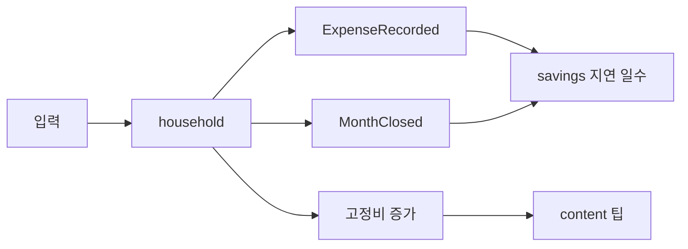

# FEATURE-013: 가계부 — 3초 입력, 막지 않는 예산

> 초안 2026-10-30. 읽기 쉬운 판 · 출처: `pm/docs/2026-10-30-money-domains-spec.html`. 도메인 이름은 `household`(ADR-002의 `ledger` 원장과 구분).

> 영역 REQ(2026-10-30): `DB-REQ-038` · `SRV-REQ-046` · `BFF-REQ-048` · `FE-REQ-057` · `RN-REQ-034` · `FC-REQ-024`(착지 채점). 결정 `ADR-005` · `ADR-006` · `ADR-007`, 전 영역 계획 `requirements/specs/to-do/MONEY-domains-global-plan.md`.

## TL;DR

- 수동 입력을 3초로: 금액 먼저 · 한 줄 입력 · 결제 문자 붙여넣기(연동 아님) · 반복 템플릿 · 밀린 날 대략 합계.
- 예산은 막지 않는다: 봉투 · 50/30/20 · 통장 쪼개기 라벨, 초과는 회색 음수로만.
- 저축과 잇는다: 지출 저장 시 "결혼 목표 3일 늦어짐"(목표 시계). 월말 착지 구간 + 채점.

## 배경과 문제

- 수동 가계부는 입력 피로와 "하루 밀리면 포기"로 끝난다. 기록 중단은 기본값이다(Epstein 외 2015).
- 직접 기록하는 수고는 효과의 일부다 — 진척 모니터링 메타분석(Harkin 외 2016), 지불 투명성(Soman 2001).
- 2024 금융이해력 조사에서 평소 재무상황 점검 43.4점(보도 기준).

## 목표

- 한 건 입력 3탭 이내. 끊겨도 다시 시작하게.
- 이번 달 착지와 목표 영향이 보인다. 판단은 사용자가.

## 사용자 시나리오

1. 점심 후 "점심 12000"을 치면 분류가 제안되고 저장된다. "결혼 목표 하루 늦어짐" 한 줄.
2. 주말에 결제 문자 6건을 붙여넣어 확인 목록에서 한 번에 저장한다(할부 3개월 1건 인식).
3. 사흘 비운 날을 "대략 4만 원"으로 메우고 다시 시작한다.

## 기능 요구사항

| ID | 요구사항 | 우선순위 | 상태 |
|---|---|---|---|
| FR-1 | 빠른 입력: 금액 먼저 · 최근 항목 · 가맹점 제안, 3탭 이내 | Must | Draft |
| FR-2 | 한 줄 입력: 금액은 숫자 확정, 분류는 서버(LLM 가능) 제안 → 확인 | Must | Draft |
| FR-3 | 결제 문자 다건 붙여넣기 → 금액 · 가맹점 · 일시 · 할부 → 확인 목록. 카드번호 · 이름 저장 전 삭제, 원문 미보관 | Must | Draft |
| FR-4 | 반복 템플릿(월세 · 통신 · 구독) + "이번 달에도 나갔나요?" 확인 | Must | Draft |
| FR-5 | 밀린 날 대략 합계 + "대략" 라벨, 통계에서 정확/대략 분리 | Must | Draft |
| FR-6 | 예산 방식(50/30/20 · 봉투 · 통장 쪼개기 라벨). 봉투별 남은 금액 · 하루 가용액. 초과는 회색 음수, 차단 없음 | Must | Draft |
| FR-7 | 월말 착지 구간 + 지난달 같은 날짜 구간 적중 | Must | Draft |
| FR-8 | 목표 시계: 지출 저장 시 저축 목표 지연 일수(household → savings 이벤트) | Must | Draft |
| FR-9 | 월 마감 리뷰 3문항(저장만, 평가 없음) | Must | Draft |
| FR-10 | 할부 · 리볼빙 띠(원거래 + 월 청구 N건, 6개월 고정 청구) | Should | Draft |
| FR-11 | 공제 계기판(총급여 25% 문턱 · 결제수단별 추정, "추정" · 기준 연도) | Should | Draft |
| FR-12 | 고정비 · 이상치 감지(약 30일 주기 · 분류 중앙값 배수) | Should | Draft |
| FR-13 | 감정 태그 + 다음 날 만족도 거울 | Should | Draft |
| FR-14 | 사람 장부(경조사 주고받기) · 비정기 경조사 봉투 | Could | Draft |
| FR-15 | 노동시간 환산(끄고 켬) | Could | Draft |
| FR-16 | 무지출일 달력(연속 일수 없음) | Could | Draft |
| FR-17 | 영수증 사진 인식(확인 단계 필수, 한국어 정확도 실측 후) | Could | Draft |
| FR-18 | 홈 요약 카드(이번 달 지출 · 착지 · 예산 남은 금액) | Must | Draft |
| FR-19 | 재미 — 내가 고르는 챌린지 · "아낀 돈" 기록(실제 적립과 구분), 실패 표시 없음 | Should | Draft |
| FR-20 | 재미 — 달력 스티커 | Should | Draft |
| FR-21 | 재미 — 월말 · 연말 이야기 카드(공유 시 금액 가림 기본) | Should | Draft |

## 비기능 요구사항

| 구분 | 요구사항 |
|---|---|
| 성능 | 저장 → 목표 시계 표시 1초 이내(이벤트 지연 시 "계산 중") |
| 접근성 | 숫자 키패드 · 스크린리더 금액 읽기 |
| 보안 | 결제 문자 원문 미보관 · 감정 태그 · 사람 장부는 민감 정보 분류 · LLM에 보내는 필드 공개(FEATURE-015 FR-5) |
| 장애 처리 | 분류 제안 실패 시 수동 분류로, 저장은 막지 않음 |
| 관측성 | 입력 방식별 사용 · 끊김 뒤 재개율(금액 제외) |

## UX 상태

- Loading: 입력 화면은 즉시(오프라인 큐 — RN)
- Empty: 예산 방식 고르기 + 첫 입력 안내
- Error: "저장 못 했어요" + 입력값 보존
- Unauthorized: 로그인으로
- Success: 목표 시계 한 줄 · 봉투 잔액 갱신

## 정책과 제약

- 카드 · 계좌 연동 없음 · 차단 · 경고 팝업 없음 · 결제수단 변경 지시 없음 · 감정 태그로 평가하는 문구 없음.
- 공제율 · 한도는 content 제도 파라미터 표에서(기준 연도).

## 화면/프론트엔드 영향

| App | Route/Component | 변경 내용 |
|---|---|---|
| `apps/web-household`(신규 zone) | `/household` · `/household/new` · `/household/month/[ym]` | `packages/domain-household` |
| RN | 가계부 탭(네이티브 입력) · 공유 시트로 문자 보내기 | 신규 RN REQ |

## BFF/API 영향

| Method | Path | Auth | Request | Response | Status |
|---|---|---|---|---|---|
| POST | `/api/app/household/expenses` | user | 금액 · 분류 · 결제수단 · 태그 | 거래 + 목표 시계 | Draft |
| POST | `/api/app/household/parse` | user | 붙여넣은 문자 / 한 줄 | 후보 목록(저장 전) | Draft |
| GET | `/api/app/household/month/:ym` | user | — | 봉투 · 착지 구간 · 리뷰 | Draft |

## 서버/DB/Worker 영향

| Layer | 위치 | 영향 |
|---|---|---|
| Server | household 서비스(Kotlin, S1) | 신규 |
| DB | `household` 스키마 | 거래 · 봉투 · 반복 템플릿 · 할부 · 태그 · 사람 장부 |
| Worker | 반복 템플릿 예정 생성(일 1회 · ShedLock) | 신규 |

## 이벤트/상태 흐름

## Trace Matrix

| 요구사항 | 화면/컴포넌트 | BFF/API | 서버/API | DB/Worker | 검증 |
|---|---|---|---|---|---|
| 전부 | 없음 | 없음 | 없음 | 없음 | Gap: 전부 신규 |

## 수용 기준

- [ ] 한 건 입력 3탭 이내(실측)
- [ ] 예산 초과 시 차단 · 팝업 0
- [ ] 결제 문자 원문이 DB · 로그에 남지 않는다
- [ ] 착지 구간에 지난달 적중 또는 "기록 부족" 이유가 있다

## 검증 계획

- 카드사 문자 형식 표본 파싱 테스트(마스킹 포함), 착지 구간 백테스트, 실스택 임시 사용자.

## Open Questions

- 공제율 · 한도 국세청 원문 대조 · 리볼빙 2025년 이후 규정
- 한국어 영수증 인식 정확도

## 변경 이력

| 날짜 | 변경 |
|---|---|
| 2026-10-30 | 초안 — 딥리서치(가계부 · 행동경제학 · 한국 맥락) · 재미 바탕 |
| 2026-10-30 | 영역 REQ 작성 · 링크(위 머리 블록) |
