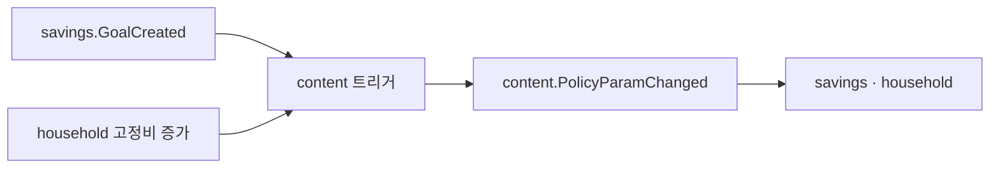

# FEATURE-014: 금융 팁 — 유통기한 있는, 때맞춘 한 줄

> 초안 2026-10-30. 읽기 쉬운 판 · 출처: `pm/docs/2026-10-30-money-domains-spec.html`. 웹은 공개 zone `apps/web-tips`.

> 영역 REQ(2026-10-30): `DB-REQ-039` · `SRV-REQ-047` · `BFF-REQ-049` · `FE-REQ-058` · RN 웹뷰(`RN-REQ-035` FR-5). 결정 `ADR-005` · `ADR-006` · `ADR-007`, 전 영역 계획 `requirements/specs/to-do/MONEY-domains-global-plan.md`.

## TL;DR

- 공적 제도 설명만(상품 · 금리 비교 · 가입 링크 · 대가 · 명령형 0). 모든 글에 출처 · 기준 연도 · 유효기한.
- 유효기한이 지나면 자동 "확인 필요" + noindex. 제도 파라미터 표의 주인(저축 · 가계부 계산이 읽는다).
- 읽을거리보다 **때맞춘 한 줄**: 결혼 목표 생성 · 연말 · 고정비 증가 같은 이벤트에 붙는다.

## 배경과 문제

- 일반 금융교육 효과는 작지만 있고(Kaiser 외 2022), 결정 시점 정보가 낫다는 제안(Fernandes 외 2014).
- 제도가 자주 바뀐다(결혼세액공제 일몰 2026-12-31 · 청년도약계좌 신규가입 2025-12-31 종료, 보도 기준).
- 금소법 광고 · 중개, 자본시장법 유사투자자문(2024-08 개정)의 선을 넘지 않아야 한다.

## 목표

- 사용자에게 해당될 수 있는 제도를 결정 시점에 알린다. 낡은 정보를 보여 주지 않는다.

## 사용자 시나리오

1. 결혼 목표를 만들면 저축 화면에 "혼인신고일 기준 · 일몰 2026-12-31" 한 줄이 뜨고 공식 페이지로 간다.
2. 검색으로 들어온 사람이 공개 글을 읽고, 로그인하면 예시 숫자가 내 값으로 바뀐다.

## 기능 요구사항

| ID | 요구사항 | 우선순위 | 상태 |
|---|---|---|---|
| FR-1 | 공개 글: 출처 · 작성일 · 검수일 · 기준 연도 · 유효기한 필수, 하나라도 없으면 발행 불가 | Must | Draft |
| FR-2 | 유효기한 경과 → "확인 필요" · noindex · 때맞춘 팁 제외 · 변경 이력 공개 | Must | Draft |
| FR-3 | 제도 파라미터 표(유효 구간)의 주인, 변경 시 `content.PolicyParamChanged` | Must | Draft |
| FR-4 | 때맞춘 팁: 도메인 이벤트 트리거(결혼 · 주거 목표, 11~12월, 5월, 고정비 증가, 신규 정기결제, 월초, 기한 없는 목표, 물가 발표, 만 34세 근접, 목표 달성). 한 번 닫으면 다시 안 띄움 | Must | Draft |
| FR-5 | 법적 선 검사기: 상품명 · 금리 비교 · 가입 링크 · 명령형 · 종목 · 매매 시점 → 발행 실패(기존 금지 표현 검증기 재사용) | Must | Draft |
| FR-6 | 내 숫자로 다시 읽기(로그인 시 서버 계산) | Should | Draft |
| FR-7 | 제도 변경 diff 뷰 | Should | Draft |
| FR-8 | 재미 — 30초 먼저 맞혀 보기 · 맞힌 문제 카드 모음 | Should | Draft |
| FR-9 | 놓친 경우 모음(실패 사례) | Could | Draft |

## 비기능 요구사항

| 구분 | 요구사항 |
|---|---|
| 성능 | ISR · 공개 페이지 LCP 2.5s 이내(휴대폰 폭 포함) |
| 접근성 | 휴대폰 폭 레이아웃 필수 — 768 미만 안내(FE-REQ-043)에서 제외 |
| 보안 | 공개 글은 개인 데이터 0. 개인화는 로그인 후 서버 렌더 |
| 장애 처리 | 개인화 실패 시 일반 예시로 |
| 관측성 | 트리거별 노출 · 닫기 · 공식 링크 이동 |

## UX 상태

- Loading: 정적 생성
- Empty: 해당 팁 없음이면 카드 자체를 안 띄움
- Error: 공개 글은 캐시본
- Unauthorized: 공개 글은 그대로, 개인화만 숨김
- Success: —

## 정책과 제약

- 무료 · 단방향 · 불특정다수. 개인화는 "해당될 수 있는 제도 + 요건 체크"까지. 법무 확인 전 공개 금지.
- 원문 위치: 레포 MDX(검수 = PR 리뷰) 안 우선.

## 화면/프론트엔드 영향

| App | Route/Component | 변경 내용 |
|---|---|---|
| `apps/web-tips`(신규 zone) | `/tips` · `/tips/[slug]` | 공개 · ISR · robots 허용 |
| 각 도메인 zone | 때맞춘 팁 카드 | `@repo/ui` 공용 카드 |

## BFF/API 영향

| Method | Path | Auth | Request | Response | Status |
|---|---|---|---|---|---|
| GET | `/api/app/tips` · `/api/app/tips/:slug` | 없음 | — | 글 · 메타 | Draft |
| GET | `/api/app/tips/for-me?context=` | user | 화면 맥락 | 때맞춘 팁 0~1건 | Draft |

## 서버/DB/Worker 영향

| Layer | 위치 | 영향 |
|---|---|---|
| Server | content 서비스(Kotlin, S2) | 신규 |
| DB | `content` 스키마 | 글 메타 · 제도 파라미터(유효 구간) · 트리거 · 닫기 기록 |
| Worker | 유효기한 점검(일 1회) | 신규 |

## 이벤트/상태 흐름

## Trace Matrix

| 요구사항 | 화면/컴포넌트 | BFF/API | 서버/API | DB/Worker | 검증 |
|---|---|---|---|---|---|
| 전부 | 없음 | 없음 | 없음 | 없음 | Gap: 전부 신규 |

## 수용 기준

- [ ] 메타 하나라도 없는 글은 발행 실패
- [ ] 유효기한 지난 글은 noindex · 트리거 제외
- [ ] 상품명 · 가입 링크 · 명령형 0건(검사기)

## 검증 계획

- 검사기 변이 테스트(금지 문장 삽입 → 실패), 유효기한 경계 테스트, 법무 검토 기록.

## Open Questions

- 금소법 제22조 · 자본시장법 제101조 원문 대조 · 법무 확인
- 원문 MDX vs DB

## 변경 이력

| 날짜 | 변경 |
|---|---|
| 2026-10-30 | 초안 — 딥리서치(규제 · 금융교육 · 금융이해력) |
| 2026-10-30 | 영역 REQ 작성 · 링크(위 머리 블록) |
