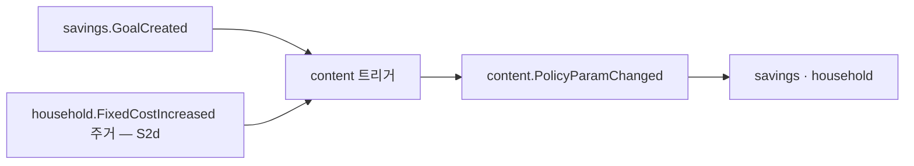

# FEATURE-014: 금융 팁 — 유통기한 있는, 때맞춘 한 줄

> 초안 2026-10-30. 읽기 쉬운 판 · 출처: `pm/docs/2026-10-30-money-domains-spec.html`. 웹은 공개 zone `apps/web-tips`.

> 영역 REQ(2026-10-30): `DB-REQ-039` · `SRV-REQ-047` · `BFF-REQ-049` · `FE-REQ-058` · RN 웹뷰(`RN-REQ-035` FR-5). 결정 `ADR-005` · `ADR-006` · `ADR-007`, 전 영역 계획 `requirements/specs/to-do/MONEY-domains-global-plan.md`.

## TL;DR

- 공적 제도 설명만(상품 · 금리 비교 · 가입 링크 · 대가 · 명령형 0). 모든 글에 출처 · 기준 연도 · 유효기한.
- 유효기한이 지나면 자동 "확인 필요" + noindex. 제도 파라미터 표의 주인(저축 · 가계부 계산이 읽는다).
- 읽을거리보다 **때맞춘 한 줄**: 결혼 목표 생성 · 연말 · 고정비 증가 같은 이벤트에 붙는다.

## 배경과 문제

- 일반 금융교육 효과는 작지만 있고(Kaiser 외 2022), 결정 시점 정보가 낫다는 제안(Fernandes 외 2014).
- 제도가 자주 바뀐다(결혼세액공제 일몰 2026-12-31 · 청년도약계좌 신규가입 2025-12-31 종료, 보도 기준).
- 금소법 광고 · 중개, 자본시장법 유사투자자문(2024-08 개정)의 선을 넘지 않아야 한다.

## 목표

- 사용자에게 해당될 수 있는 제도를 결정 시점에 알린다. 낡은 정보를 보여 주지 않는다.

## 사용자 시나리오

1. 결혼 목표를 만들면 저축 화면에 "혼인신고일 기준 · 일몰 2026-12-31" 한 줄이 뜨고 공식 페이지로 간다.
2. 검색으로 들어온 사람이 공개 글을 읽고, 로그인하면 예시 숫자가 내 값으로 바뀐다.

## 기능 요구사항

| ID | 요구사항 | 우선순위 | 상태 |
|---|---|---|---|
| FR-1 | 공개 글: 출처 · 작성일 · 검수일 · 기준 연도 · 유효기한 필수, 하나라도 없으면 발행 불가 | Must | **Done(S2a 2026-11-05)** — 빌드 + 기동 검사 |
| FR-2 | 유효기한 경과 → "확인 필요" · noindex · 때맞춘 팁 제외 · 변경 이력 공개 | Must | **Done(S2a)** — 당일까지 유효 |
| FR-3 | 제도 파라미터 표(유효 구간)의 주인, 변경 시 `content.PolicyParamChanged` | Must | **Done(S2a)** — 구독자는 법무 확인 뒤 |
| FR-4 | 때맞춘 팁: 도메인 이벤트 트리거(결혼 · 주거 목표, 11~12월, 5월, 고정비 증가, 신규 정기결제, 월초, 기한 없는 목표, 물가 발표, 만 34세 근접, 목표 달성). 한 번 닫으면 다시 안 띄움 | Must | **In progress(S2a · S2d)** — 결혼 · 주거 · 목표 달성 · 5월 · 11~12월 · 닫기 · **고정비 증가(주거) → 월세 세액공제(S2d)**. 나머지(신규 정기결제 · 월초 · 기한 없는 목표 · 물가 · 만 34세)는 원천 이벤트 · 붙일 글이 생길 때 |
| FR-5 | 법적 선 검사기: 상품명 · 금리 비교 · 가입 링크 · 명령형 · 종목 · 매매 시점 → 발행 실패(기존 금지 표현 검증기 재사용) | Must | **Done(S2a)** — 코치 검증기 꼴을 옮겨 적음, 한 모듈은 S6 |
| FR-6 | 내 숫자로 다시 읽기(로그인 시 서버 계산) | Should | **Done(S2d 2026-11-05)** — 주택청약 · 결혼 · 예금보호 · 월세 넷. 저축 목표 · 가계부 급여를 BFF 가 읽어 content 가 계산 · 요건 맞아요 · 아니에요 · 모름(앱이 모르는 요건은 늘 모름) |
| FR-7 | 제도 변경 diff 뷰 | Should | **Done(S2b 2026-11-05)** — 이력 목록(S2a) + 줄 diff(바뀐 줄만 · 모르는 판은 요약만) |
| FR-8 | 재미 — 30초 먼저 맞혀 보기 · 맞힌 문제 카드 모음 | Should | **Done(S2b 2026-11-05)** — 정답은 서버 · 로그인이면 처음 맞힌 때 카드 · 시간 제한 0("30초"는 문제 길이 목표) |
| FR-9 | 놓친 경우 모음(실패 사례) | Could | Draft |

## 비기능 요구사항

| 구분 | 요구사항 |
|---|---|
| 성능 | ISR · 공개 페이지 LCP 2.5s 이내(휴대폰 폭 포함) |
| 접근성 | 휴대폰 폭 레이아웃 필수 — 768 미만 안내(FE-REQ-043)에서 제외 |
| 보안 | 공개 글은 개인 데이터 0. 개인화는 로그인 후 서버 렌더 |
| 장애 처리 | 개인화 실패 시 일반 예시로 |
| 관측성 | 트리거별 노출 · 닫기 · 공식 링크 이동 |

## UX 상태

- Loading: 정적 생성
- Empty: 해당 팁 없음이면 카드 자체를 안 띄움
- Error: 공개 글은 캐시본
- Unauthorized: 공개 글은 그대로, 개인화만 숨김
- Success: —

## 정책과 제약

- 무료 · 단방향 · 불특정다수. 개인화는 "해당될 수 있는 제도 + 요건 체크"까지. 법무 확인 전 공개 금지.
- 원문 위치: 레포 MDX(검수 = PR 리뷰) 안 우선.

## 화면/프론트엔드 영향

| App | Route/Component | 변경 내용 |
|---|---|---|
| `apps/web-tips`(신규 zone) | `/tips` · `/tips/[slug]` | 공개 · ISR · ~~robots 허용~~ robots 는 서버 공개 플래그(법무 확인 전 noindex) — S2a |
| `apps/web-tips` | 글 위 "읽기 전에 맞혀 보기" · `/tips/cards` 맞힌 카드 모음(개인 · noindex) · 목록에서 모음으로 가는 줄 | S2b |
| `apps/web-tips` | 글 본문 아래 "내 숫자로 다시 읽기" — 로그인한 사람에게만 부르는 잎(글 HTML 은 사람마다 같다) | S2d |
| 각 도메인 zone | 때맞춘 팁 카드 | `@repo/ui` 공용 카드 — 저축 · 가계부(S2a), 홈은 S3 |

## BFF/API 영향

| Method | Path | Auth | Request | Response | Status |
|---|---|---|---|---|---|
| GET | `/api/app/tips` · `/api/app/tips/:slug` | 없음 | — | 글 · 메타 · 이력(바뀐 줄) · 퀴즈(정답 없음) | Done(S2a · S2b) |
| GET | `/api/app/tips/for-me?context=` | user | 화면 맥락 | 때맞춘 팁 0~1건 | Done(S2a) |
| POST | `/api/app/tips/:slug/dismiss` | user | — | 닫힘 | Done(S2a) |
| POST | `/api/app/tips/:slug/quiz` | 있으면 씀 | `{ choice }` | 맞음 · 정답 · 풀이 · 카드가 됐나 | Done(S2b) |
| GET | `/api/app/tips/quiz-cards` | user | — | 맞힌 카드 · 문제 수 | Done(S2b) |
| GET | `/api/app/tips/:slug/my-numbers` | user | — | 숫자(금액 · 비율) · 요건(met · not_met · unknown) · 못 읽은 원천 | Done(S2d) |

## 서버/DB/Worker 영향

| Layer | 위치 | 영향 |
|---|---|---|
| Server | content 서비스(Kotlin, S2) | 신규 |
| DB | `content` 스키마 | 글 메타 · 변경 이력(+ 그 판의 줄, S2b) · 제도 파라미터(유효 구간) · 트리거 · 닫기 기록 · 사용자 신호 · 퀴즈 기록(S2b) |
| Worker | 유효기한 점검 | ~~일 1회~~ 매시 15분(멱등 — 놓친 날을 메운다, S2a) |

## 이벤트/상태 흐름

## Trace Matrix

| 요구사항 | 화면/컴포넌트 | BFF/API | 서버/API | DB/Worker | 검증 |
|---|---|---|---|---|---|
| ~~전부~~ | ~~없음~~ | ~~없음~~ | ~~없음~~ | ~~없음~~ | ~~Gap: 전부 신규~~ **정정 2026-11-05(S2b 확인 3회차)** — 본문 표가 착수 전 모양 그대로였다(S2a · S2b 가 상태 칸만 고침). |
| FR-1 · 5 | — | — | `PublishCheck` · `LegalLine` | 원문 파일 · `tip` NOT NULL | `ContentSpec` · `CatalogSpec` · 종단 |
| FR-2 | 확인 필요 띠 · noindex | `noindex` | `RunValidityCheck` | `ContentWorker` | `ContentSpec` 경계 |
| FR-3 | — | — | `GET /api/content/policy-params/{key}` · `PolicyParamChanged` | `policy_param` 트리거 | 종단(23P01) |
| FR-4 | `TimelyTip` | `for-me` · `dismiss` | `TimelyTipPicker` · 저축 이벤트 구독 · 가계부 고정비 증가 구독(S2d) | `user_signal` · `tip_dismissal` | 종단(실 RabbitMQ) · 실화면 |
| FR-6 | `MyNumbersPanel`(`read-my-numbers`) | `my-numbers`(저축 · 가계부 → content) | `MyNumbers` · `ReadMyNumbers` | 저장 0 · 파라미터 표 | `MyNumbersSpec` · 종단 · 실화면 |
| FR-7 | `RevisionList` | `revisions[].changes` | `LineDiff` | `tip_revision.body_lines` | `QuizDiffSpec` · 종단 · 실화면 |
| FR-8 | `AnswerQuiz` · `/tips/cards` | `quiz` · `quiz-cards` | `GradeQuiz` · `AnswerQuiz` · `ListQuizCards` | `quiz_answer` | `QuizDiffSpec` · 종단 · 실화면 |
| FR-9 | — | — | — | — | Gap: 범위 밖(Could) |

## 수용 기준

- [x] 메타 하나라도 없는 글은 발행 실패 — `ContentSpec` 여덟 칸 · `CatalogSpec`(S2a)
- [x] 유효기한 지난 글은 noindex · 트리거 제외 — 당일 유효 · 다음 날 확인 필요(S2a)
- [x] 상품명 · 가입 링크 · 명령형 0건(검사기) — 변이 12 + 오탐 경계 9, S2b 부터 퀴즈 문장까지(S2b)

## 검증 계획

- 검사기 변이 테스트(금지 문장 삽입 → 실패), 유효기한 경계 테스트, 법무 검토 기록.

## Open Questions

- 금소법 제22조 · 자본시장법 제101조 원문 대조 · 법무 확인 — **확인 받기로 결정(2026-10-30)**. 검토 범위: 팁 글 · 때맞춘 팁 · 공제 계기판(F013 FR-11) · 제도 계산(F012 FR-12). 확인 기록 전 공개 금지
- ~~원문 MDX vs DB~~ **닫힘 2026-11-05** — 레포 원문 파일(서버 `content` 가 주인, 마크다운 세 꼴만 읽어 구조로). 검수 = PR 리뷰 + 빌드 검사

## 변경 이력

| 날짜 | 변경 |
|---|---|
| 2026-10-30 | 초안 — 딥리서치(규제 · 금융교육 · 금융이해력) |
| 2026-10-30 | 영역 REQ 작성 · 링크(위 머리 블록) |
| 2026-10-30 | 공개 전 법무 확인 받기로 결정(사용자) |
| 2026-11-05 | 금융 팁 S2a + F5a(`MONEY-S2a-tips-content`) — FR-1 · 2 · 3 · 5 done · FR-4 · 7 진행 · 원문 위치 열린 질문 닫음 · 공개는 법무 확인 전 꺼짐 |
| 2026-11-05 | 금융 팁 S2b(`MONEY-S2b-tips-quiz-diff`) — FR-7 · 8 done · FR-6 · 4 나머지는 S2d |
| 2026-11-05 | 금융 팁 S2b 확인 3회차 — 본문 표(화면 · BFF · 서버/DB · Trace Matrix · 수용 기준)가 착수 전 모양 그대로였다 → 구현 현황으로 정정 · 수용 기준 셋 체크(S2a 에 이미 참) |
| 2026-11-05 | 금융 팁 S2d(`MONEY-S2d-tips-my-numbers`) — FR-6 done(BFF 가 원천을 읽고 content 가 계산 · 넷) · FR-4 고정비 증가(주거) + 월세 세액공제 글. 나머지 트리거는 원천 · 글이 생길 때 |
| 2026-11-13 | 서버 S3d(루트 `requirements/specs/done/MONEY-S3d-identity-classify-usage-slice.md`) 중 발견 — 금융 팁 zone(`web-tips` 3005)이 `ops/salt.sh` 에 없어 아무도 띄우지 않았다(셸 `/tips` 프록시가 죽어 있었다). 이름 표 · `DEV_APPS` 에 넣음(`FE-REQ-058` · `OPS-002` FR-8). 팁 데이터 칸은 개인정보 패널에 "금융 팁 — 기록"으로 나온다 |
