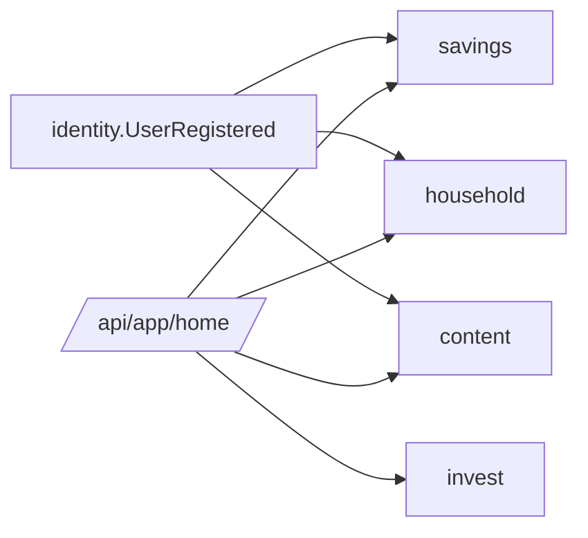

# FEATURE-015: 셸 — 홈 · 온보딩 · 내 데이터

> 초안 2026-10-30. 읽기 쉬운 판: `pm/docs/2026-10-30-money-domains-spec.html`. 투자 동결 범위도 같은 문서에 있다.

> 영역 REQ(2026-10-30): `DB-REQ-040` · `SRV-REQ-048` · `BFF-REQ-046` · `FE-REQ-054` · `FE-REQ-055` · `RN-REQ-035`. 결정 `ADR-005` · `ADR-006` · `ADR-007`, 전 영역 계획 `requirements/specs/to-do/MONEY-domains-global-plan.md`.

## TL;DR

- 앱 IA를 **홈 · 저축 · 가계부 · 투자** 4탭으로. 온보딩은 "무엇을 관리하고 싶나"를 고르는 것으로.
- 홈은 도메인 요약 카드(`HomeSummaryCard`)만 — 셸은 도메인 코드를 모른다(프론트 설계 규칙 §2).
- 내 데이터 내보내기 · 삭제, 도메인별 알림(기본 꺼짐), 개인정보 범위 갱신.

## 배경과 문제

- 온보딩(초대 → 첫 보유 기록 → 적립액)과 홈 브리핑이 투자 중심이다. F006 3탭(홈 · 코치 · 자산)도 투자 IA다.
- 가계부 · 결제 문자 같은 민감 데이터를 받으면 내보내기 · 삭제가 신뢰 조건이 된다.

## 목표

- 첫 화면부터 돈 관리 앱으로 보인다. 투자를 안 하는 사람도 끝까지 쓸 수 있다.

## 사용자 시나리오

1. 가입 후 "모으기 · 쓰는 돈"을 고르고 결혼 목표 하나만 만들고 끝낸다. 투자는 묻지 않는다.
2. 홈에서 카드 순서를 가계부 → 저축으로 바꾼다.

## 기능 요구사항

| ID | 요구사항 | 우선순위 | 상태 |
|---|---|---|---|
| FR-1 | 온보딩: 도메인 선택(모으기 · 쓰는 돈 · 투자) → 고른 도메인 첫 입력 하나 → 끝(3단계 이내) | Must | Draft |
| FR-2 | 홈 = `HomeSummaryCard[]`, 순서 · 숨김 사용자 설정 | Must | Draft |
| FR-3 | 내 데이터 내보내기(CSV · JSON) · 계정 삭제 시 전부 삭제 + 범위 표시 | Must | Draft |
| FR-4 | 알림 도메인별 설정, 기본 꺼짐(F000 FR-50 게이트 확장) | Must | Draft |
| FR-5 | 개인정보 범위: 결제 문자 원문 미보관 · 민감 정보 분류 · LLM 전송 필드 공개 | Must | Draft |
| FR-6 | 도메인 사용 계측(주간 활성 · 재개율 · 카드 클릭, 금액 제외) | Should | Draft |
| FR-7 | 도메인 색 토큰 추가(기존 색 변경 없음) | Should | Draft |
| FR-8 | 하단 탭 · 헤더 `AppChrome` 공용 컴포넌트 + zone 간 미리 렌더 · 문서 간 전환 | Must | Draft |

## 비기능 요구사항

| 구분 | 요구사항 |
|---|---|
| 성능 | 홈 카드 4장 병렬(allSettled), 한 도메인 실패해도 홈 표시 |
| 접근성 | 탭 · 카드 키보드 이동 |
| 보안 | 내보내기 파일은 본인만, 삭제는 재인증 |
| 장애 처리 | 카드별 `degraded` |
| 관측성 | zone 간 전환 시간(미리 렌더 적중률) |

## UX 상태

- Loading: 카드별 서버 렌더
- Empty: 고른 도메인의 첫 입력 안내 카드
- Error: 해당 카드만 `degraded`
- Unauthorized: 로그인
- Success: —

## 정책과 제약

- 연동 문구 금지 · 막지 않는다 · 금액은 서버.

## 화면/프론트엔드 영향

| App | Route/Component | 변경 내용 |
|---|---|---|
| `apps/web`(셸) | `/` · `/home` · `/onboarding` · 설정 | 도메인 import 제거, 카드 조립 |
| `packages/ui` | `AppChrome` | 신규 |
| `packages/core` | `HomeSummaryCard` · zones 5개 | 신규 · 갱신 |

## BFF/API 영향

| Method | Path | Auth | Request | Response | Status |
|---|---|---|---|---|---|
| GET | `/api/app/home` | user | — | `HomeSummaryCard[]` (계약 변경) | Draft |
| POST | `/api/app/onboarding` | user | 도메인 선택 · 첫 입력 | 다음 단계 | Draft — 기존 3스텝 대체 |
| POST | `/api/app/me/export` | user | 형식 | 파일 | Draft |

## 서버/DB/Worker 영향

| Layer | 위치 | 영향 |
|---|---|---|
| Server | identity(Kotlin, S3) · BFF 홈 조립 | 온보딩 · 내보내기 · 삭제 |
| DB | `identity` 스키마 | 도메인 선택 · 카드 순서 · 알림 설정 |
| Worker | 없음 | — |

## 이벤트/상태 흐름

## Trace Matrix

| 요구사항 | 화면/컴포넌트 | BFF/API | 서버/API | DB/Worker | 검증 |
|---|---|---|---|---|---|
| FR-1 | onboarding-flow 있음(투자 3스텝) | `/api/app/onboarding` 있음 | onboarding 컨텍스트 | — | Gap: 도메인 선택으로 재작성 |
| FR-2 | home-briefing 있음(coach · portfolio 직접 읽음) | `/api/app/home` 있음 | — | — | Gap: 카드 계약으로 교체 |
| 그 외 | 없음 | 없음 | 없음 | 없음 | Gap: 신규 |

## 수용 기준

- [ ] 셸 코드에 `domain-*` import 0(lint)
- [ ] 투자를 고르지 않은 사용자에게 투자 질문 0
- [ ] 내보내기 파일에 모든 도메인 기록이 있다

## 검증 계획

- 온보딩 경로 3종 E2E, 홈 카드 한 도메인 강제 실패, 내보내기 · 삭제 실스택 임시 사용자.

## Open Questions

- F006 3탭을 투자 zone 내부 탭으로 다시 쓰는 범위(F006 문서 갱신 필요)

## 변경 이력

| 날짜 | 변경 |
|---|---|
| 2026-10-30 | 초안 |
| 2026-10-30 | 영역 REQ 작성 · 링크(위 머리 블록) |
