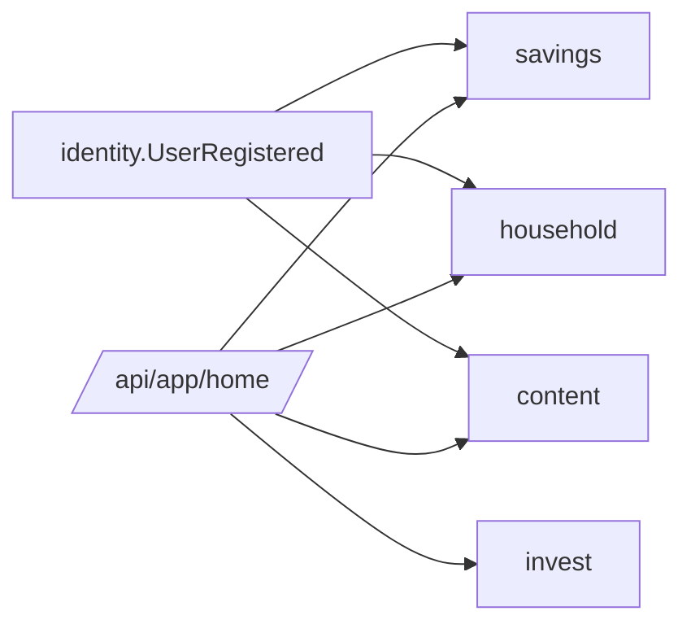

# FEATURE-015: 셸 — 홈 · 온보딩 · 내 데이터

> 초안 2026-10-30. 읽기 쉬운 판: `pm/docs/2026-10-30-money-domains-spec.html`. 투자 동결 범위도 같은 문서에 있다.

> 영역 REQ(2026-10-30): `DB-REQ-040` · `SRV-REQ-048` · `BFF-REQ-046` · `FE-REQ-054` · `FE-REQ-055` · `RN-REQ-035`. 결정 `ADR-005` · `ADR-006` · `ADR-007`, 전 영역 계획 `requirements/specs/to-do/MONEY-domains-global-plan.md`.

## TL;DR

- 앱 IA를 **홈 · 저축 · 가계부 · 투자** 4탭으로. 온보딩은 "무엇을 관리하고 싶나"를 고르는 것으로.
- 홈은 도메인 요약 카드(`HomeSummaryCard`)만 — 셸은 도메인 코드를 모른다(프론트 설계 규칙 §2).
- 내 데이터 내보내기 · 삭제, 도메인별 알림(기본 꺼짐), 개인정보 범위 갱신.

## 배경과 문제

- 온보딩(초대 → 첫 보유 기록 → 적립액)과 홈 브리핑이 투자 중심이다. F006 3탭(홈 · 코치 · 자산)도 투자 IA다.
- 가계부 · 결제 문자 같은 민감 데이터를 받으면 내보내기 · 삭제가 신뢰 조건이 된다.

## 목표

- 첫 화면부터 돈 관리 앱으로 보인다. 투자를 안 하는 사람도 끝까지 쓸 수 있다.

## 사용자 시나리오

1. 가입 후 "모으기 · 쓰는 돈"을 고르고 결혼 목표 하나만 만들고 끝낸다. 투자는 묻지 않는다.
2. 홈에서 카드 순서를 가계부 → 저축으로 바꾼다.

## 기능 요구사항

| ID | 요구사항 | 우선순위 | 상태 |
|---|---|---|---|
| FR-1 | 온보딩: 도메인 선택(모으기 · 쓰는 돈 · 투자) → 고른 도메인 첫 입력 하나 → 끝(3단계 이내) | Must | **구현 2026-11-06**(서버 S3a — 초대 → 고르기 → 첫 기록(고른 것 중 기본 순서 첫째 도메인의 입력 화면) → 끝. 투자를 안 고르면 투자 질문 0 · 옛 3스텝 은퇴. `SRV-REQ-048` FR-1 · `BFF-REQ-046` FR-6 · `FE-REQ-055` FR-4) |
| FR-2 | 홈 = `HomeSummaryCard[]`, 순서 · 숨김 사용자 설정 | Must | ~~부분(2026-11-02) — 카드 계약 · 셸 홈 카드 · 기본 순서(`FE-REQ-055` · `BFF-REQ-046`). 순서 · 숨김 편집은 identity(S3)~~ **구현 2026-11-06**(서버 S3a) — 순서 · 숨김 저장은 identity · 편집은 셸 `/settings` 패널(홈은 읽기 전용) · 저장 전 기본값은 서버(안 고른 도메인 숨김) |
| FR-3 | 내 데이터 내보내기(CSV · JSON) · 계정 삭제 시 전부 삭제 + 범위 표시 | Must | Draft |
| FR-4 | 알림 도메인별 설정, 기본 꺼짐(F000 FR-50 게이트 확장) | Must | **구현 2026-11-06**(서버 S2c — 셸 `/settings` 알림 패널 · 투자 = 코치 판단 변화 · 저축 = 목표 도달 · 가계부 = 고정비 오름. 기존 사용자의 투자 알림도 켜야 온다. 알림 목록 · 벨은 F006 · 푸시는 RN) |
| FR-5 | 개인정보 범위: 결제 문자 원문 미보관 · 민감 정보 분류 · LLM 전송 필드 공개 | Must | Draft |
| FR-6 | 도메인 사용 계측(주간 활성 · 재개율 · 카드 클릭, 금액 제외) | Should | Draft |
| FR-7 | 도메인 색 토큰 추가(기존 색 변경 없음) | Should | Draft |
| FR-8 | 하단 탭 · 헤더 ~~`AppChrome`~~ **`AppNavigation`**(이름 정정 2026-11-03) 공용 컴포넌트 + zone 간 미리 렌더 · 문서 간 전환 | Must | **Done** 2026-11-03(`FE-REQ-054` done) — 레일 · 하단 탭 · 머리 · prerender 규칙 · 전환 · 계측(`FE-REQ-054`). ~~prerender 적중 사람 확인~~ **2026-11-03 확인 — 운영 빌드 prerender 적중 10/10 · 이동 중앙 0~1ms(미적중 101 · 145ms) · 녹화 깜빡임 0** · ~~공용 청크 캐시 공유(`OPS-001`)~~ 캐시 공유 닫음(운영 공용 `/_next`, `ADR-005` 규칙 7 개정) · 계측 수집처 · 배포 정적 저장소(`OPS-001` FR-12) 남음 |

## 비기능 요구사항

| 구분 | 요구사항 |
|---|---|
| 성능 | 홈 카드 4장 병렬(allSettled), 한 도메인 실패해도 홈 표시 |
| 접근성 | 탭 · 카드 키보드 이동 |
| 보안 | 내보내기 파일은 본인만, 삭제는 재인증 |
| 장애 처리 | 카드별 `degraded` |
| 관측성 | zone 간 전환 시간(미리 렌더 적중률) |

## UX 상태

- Loading: 카드별 서버 렌더
- Empty: 고른 도메인의 첫 입력 안내 카드
- Error: 해당 카드만 `degraded`
- Unauthorized: 로그인
- Success: —

## 정책과 제약

- 연동 문구 금지 · 막지 않는다 · 금액은 서버.

## 화면/프론트엔드 영향

| App | Route/Component | 변경 내용 |
|---|---|---|
| `apps/web`(셸) | `/` · `/home` · `/onboarding` · 설정 | 도메인 import 제거, 카드 조립 |
| `packages/ui` | ~~`AppChrome`~~ **`AppNavigation`**(2026-11-03 생김) | 신규 |
| `packages/core` | `HomeSummaryCard` · zones 5개 | 신규 · 갱신 |

## BFF/API 영향

| Method | Path | Auth | Request | Response | Status |
|---|---|---|---|---|---|
| GET | `/api/app/home` | user | — | `HomeSummaryCard[]` (계약 변경) | Draft |
| ~~POST~~ GET · PUT · POST | `/api/app/onboarding` · `/domains` · `/finish` | user | 도메인 선택 · 끝내기 | 다음 단계 · 첫 기록 화면 | **구현 2026-11-06** — 기존 3스텝 `/status` 410 은퇴 |
| PUT | `/api/app/home/layout` | user | 순서 · 숨김 | 저장된 배치 | **구현 2026-11-06** |
| POST | `/api/app/me/export` | user | 형식 | 파일 | Draft |

## 서버/DB/Worker 영향

| Layer | 위치 | 영향 |
|---|---|---|
| Server | identity(Kotlin, S3) · BFF 홈 조립 | 온보딩 · 내보내기 · 삭제 |
| DB | `identity` 스키마 | 도메인 선택 · 카드 순서 · 알림 설정 |
| Worker | 없음 | — |

## 이벤트/상태 흐름

## Trace Matrix

| 요구사항 | 화면/컴포넌트 | BFF/API | 서버/API | DB/Worker | 검증 |
|---|---|---|---|---|---|
| FR-1 | ~~onboarding-flow 있음(투자 3스텝)~~ **onboarding-flow 도메인 선택 · `choose-domains`(2026-11-06)** | `/api/app/onboarding` ~~있음~~ **새 계약** | ~~onboarding 컨텍스트~~ **Kotlin identity**(Express 조합 컨텍스트 삭제) | `identity.user_domain_pref` | ~~Gap: 도메인 선택으로 재작성~~ **재작성함** — 종단 테스트 · 실화면 네 길 |
| FR-2 | ~~home-briefing 있음(coach · portfolio 직접 읽음)~~ **`entities/home` 카드(2026-11-02)** | `/api/app/home` ~~있음~~ **카드 계약** · `/home/layout` | identity `/shell/layout` | `user_domain_pref` | ~~Gap: 카드 계약으로 교체~~ **교체함 — ~~편집만 남음(S3)~~ 편집 2026-11-06(설정 패널)** |
| 그 외 | 없음 | 없음 | 없음 | 없음 | Gap: 신규 |

## 수용 기준

- [x] 셸 코드에 `domain-*` import 0(lint) — lint · 훅(2026-11-02 부터, 2026-11-06 `pnpm lint` 통과)
- [x] 투자를 고르지 않은 사용자에게 투자 질문 0 — 2026-11-06 S3a(도메인 테스트 · 종단 테스트 · 실화면)
- [ ] 내보내기 파일에 모든 도메인 기록이 있다

## 검증 계획

- 온보딩 경로 3종 E2E, 홈 카드 한 도메인 강제 실패, 내보내기 · 삭제 실스택 임시 사용자.

## Open Questions

- F006 3탭을 투자 zone 내부 탭으로 다시 쓰는 범위(F006 문서 갱신 필요)

## 변경 이력

| 날짜 | 변경 |
|---|---|
| 2026-10-30 | 초안 |
| 2026-10-30 | 영역 REQ 작성 · 링크(위 머리 블록) |
| 2026-11-02 | 아키텍처 바탕 F0 `FE-REQ-052` done — 셸 `apps/web` + 도메인 zone 4 빈 골격 · 레지스트리 `registry.json` · lint 도메인 축 · `web-tax` 삭제. 셸 책임(인증 · 온보딩 · 홈 · 설정)이 레지스트리 경로로 고정(`/` `/home` `/login` `/onboarding` `/settings`). 화면 기능 변경 0. 루트 `requirements/specs/done/MONEY-F0-domain-zones-slice.md` |
| 2026-11-02 | F1 — 홈 = 도메인 요약 카드(FR-2 부분: 카드 · 기본 순서, 편집은 S3) · 셸 `/settings` = 도메인별 설정 링크 목록(FR-3 · 4 자리) · 로그인 상태 `/` → 서버에서 `/home`. 투자 화면은 투자 zone 으로(`FE-REQ-053` done). 루트 `requirements/specs/done/MONEY-F1-invest-zone-home-cards-slice.md` |
| 2026-11-03 | F2 — FR-8 In progress(`FE-REQ-054`, 루트 `requirements/specs/done/MONEY-F2-app-navigation-slice.md`). 이름 `AppNavigation`(사용자 결정). FR-7 도메인 색 토큰 추가(기존 값 diff 0). 저축 · 가계부 탭은 첫 화면이 생길 때까지 "준비 중"(`FE-REQ-056` · `057`) |
| 2026-11-03 | F2 미검증 닫기 — prerender 적중 10/10 · 녹화 깜빡임 0 · 공용 청크 캐시 공유(운영 빌드 공용 `/_next` · `ADR-005` 규칙 7 개정) · 저축 아이콘 동전(W). 결함 1(prerender 도착 계측) 수정 |
| 2026-11-03 | FR-8 Done — `FE-REQ-054` done. 루트 `requirements/specs/done/MONEY-F2-app-navigation-slice.md` |
| 2026-11-03 | S1a — 저축 탭 활성(`APP_TABS` readyBy null) · 홈 저축 카드 원천 Kotlin 저축 서비스 + 진척 최대 목표 한 줄 · 홈 임시 목표 목록 삭제 · 온보딩 `set_plan` 이 저축 서비스에 묻는다. 루트 `MONEY-S1a-savings-calculator-slice.md` |
| 2026-11-04 | 가계부 S1a — 홈에 가계부 카드(이번 달 지출 + 예산 남은 금액 | 월말 예상 구간, `BFF-REQ-046`) · 가계부 탭이 눌린다(`FE-REQ-054`) |
| 2026-11-04 | 홈 디자인 `FE-REQ-048` 정정(카드 2×2 데스크톱 · 목록 행 모바일) · 좁은 화면 안내 `FE-REQ-061` · 움직임 `FE-REQ-062`(to-do) |
| 2026-11-04 | 가계부 S1c — FR-5 민감 정보 분류에 두 표가 더해졌다: 감정 태그 · 만족(`household.expense_tag`) · 급여(`household.household_setting`) — 표 주석 `sensitive` · 이벤트 · 로그 0. 루트 `MONEY-S1c-household-mirror-slice.md` |
| 2026-11-05 | 앱 머리 계정 메뉴가 홈 카드에 깔려 로그아웃을 누를 수 없던 결함 수정(`99efcd15`, `FE-REQ-054`) · 로그인 · 초대 수락 · 로그아웃이 쿠키 세션으로(`FE-REQ-013` FR-80 2단계). 루트 `requirements/specs/done/F000-cookie-session-slice.md` |
| 2026-11-05 | 금융 팁 S2a(`MONEY-S2a-tips-content`) — `FE-REQ-054` — 금융 팁은 탭이 아니라 `AppShell` 대신 `PublicShell`(앱 내비 · prerender 없음). 홈 때맞춘 팁 카드(`SRV-REQ-047` FR-9 · 홈 카드 묶음)는 아직 — S2b 또는 S3 |
| 2026-11-05 | 금융 팁 S2b(`MONEY-S2b-tips-quiz-diff`) — `FE-REQ-054` 앱 내비 공개 경로 판정을 `@repo/core/auth` `isPublicPath` 로(동작 무변경, `cf93acb1`). 홈 금융 팁 카드(`SRV-REQ-047` FR-9)는 ~~S2b 또는 S3~~ S3 |
| 2026-11-06 | 서버 S2c(`MONEY-S2c-notification`) — FR-4 구현: 도메인별 알림 설정 기본 꺼짐(설정 주인 notification 서비스) · 알림 원인 셋 · 셸 `/settings` 패널. 가계부 월 마감은 알리지 않는다(사용자가 한 일) |
| 2026-11-06 | 서버 S3a(`MONEY-S3a-identity-shell`, 루트 `requirements/specs/done/MONEY-S3a-identity-shell-slice.md`) — FR-1 구현(도메인 선택 온보딩 · 옛 3스텝 은퇴) · FR-2 구현(순서 · 숨김 — 설정 패널). 수용 기준 1 · 2 충족. 남은 FR-3 · 5 · 6(S3c) · 토큰 발급 교체(S3b) |
| 2026-11-06 | 서버 S3a 확인 2회차 — 결함 1(만료 세션 온보딩 멈춤) 고침 · 실패 · 만료 경로 실화면 |
| 2026-11-09 | FE-067(루트 `FE-066-067-search-header-slice.md`) — 1024+ 앱 내비가 왼쪽 레일에서 머리 글자 링크로(사용자 D1 안 B) · 머리 검색칸 · FR-8 하단 탭(768~1023) · 앱 탭 그대로. `FE-REQ-054` FR-1 정정 |
| 2026-11-10 | 머리 내비(`FE-REQ-067`) done — zone 전환 A/B 퇴행 0(prerender 적중 10/10) |
